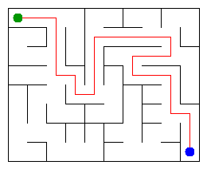

# Assignment 3. Maze Escape

- Student ID (barcode): 252914
- Name: Yelubek Bakdaulet
- Group: se-2512
- Maze size (rows x columns): 8 x 10

The personal input files were generated from Student ID `252914` using the supplied `MakeVariant` tool. The output and picture below are from this personal 8 x 10 maze.

The assignment is in [docs/Assignment3.pdf](docs/Assignment3.pdf); the starter instructions are in [START_HERE.md](START_HERE.md).

## Run and checks

Java 17 or newer is required. Run these commands from the project directory:

```sh
javac -d out src/*.java
java tools/MakeVariant.java 252914 data
java -Djava.awt.headless=true -cp out Main
```

The generator command recreates the personal input files for Student ID `252914`. The last command prints the 13 results and writes `output/maze.png` and `output/maze.html`; open the HTML file in a browser to explore the maze. The headless option lets Java generate the PNG without opening a desktop window, including in environments without a graphical session.

To run the provided and additional checks:

```sh
JAVA_TOOL_OPTIONS=-Djava.awt.headless=true java tools/Check.java
java -cp out DisjointSetTest
java -Xmx512m -Xss256k -cp out tools/AlgorithmChecks.java --stress
```

Validation completed with OpenJDK 21.0.12.1:

- `javac --release 17 -Xlint:all -d out src/*.java` compiles without warnings.
- The provided `tiny`, `small` and `dag` examples match all 13 expected output lines.
- The personal variant has 80 cells and 142 walls; Kruskal and Prim both give an MST cost of 25253.
- DSU checks include self-union, union by size, set counts and a million-element chain.
- 3,629 additional checks include exhaustive MST enumeration on small grids, a DFS backtracking case, SCC comparison with transitive closure, shortest routes compared with Bellman-Ford, parallel zone edges, isolated components and totals larger than a 32-bit integer.
- With a 256 KiB Java call stack, DFS handles a 1000 x 1000 snake maze whose route contains 999,001 cells. Kosaraju and zone routing handle a directed chain of 1,000,000 cells.

## Program output

Personal results for Student ID `252914`, produced with the files in `data/`:

```sh
java -Djava.awt.headless=true -cp out Main
```

```text
Broken: 79
Kept: 63
Last broken wall: 98
MST cost: 25253
Heaviest broken wall: 903
Path length: 26
DFS visited: 40
Dead ends: 23
Zones: 12
Largest zone: 11
Is DAG: 0
Flow stages: 9
Fastest route cost: 20
```

The same output is saved in [output/results.txt](output/results.txt).

Personal maze (green start, blue exit and red escape path):



## Questions

### Mission 0. What do find and union do, and what makes them fast?

`find(x)` returns the representative of the set containing `x`, and `union(a, b)` joins two different sets, returning whether a merge happened. Union by size attaches the smaller tree below the larger one, while path compression makes every cell visited by `find` point directly to its root. Together they give amortized O(alpha(n)) time per operation, where alpha is the inverse Ackermann function.

### Mission 1. Why is Broken always R*C - 1, and Kept always (R-1)*(C-1)?

The complete rectangular grid is connected, and a wall is broken only when it joins two previously separate components, so the result is a spanning tree with R*C - 1 edges. The grid has R*(C-1) + C*(R-1) inner walls; subtracting R*C - 1 broken walls leaves (R-1)*(C-1) kept walls.

### Mission 2. MST costs from Kruskal and Prim, and why they are equal

For my personal maze, Kruskal and Prim both give an MST cost of 25253. Kruskal chooses the cheapest edge that joins different components, while Prim repeatedly chooses the cheapest edge leaving its current tree, and both choices follow the MST cut property. Because all wall costs in the assignment are distinct, the minimum spanning tree is unique, so both algorithms produce the same total cost.

### Mission 3. Why is there exactly one path, and how is stack overflow avoided?

The broken walls form a connected graph without a cycle, so two different paths between the same cells would contradict the tree property by creating a cycle. DFS uses an explicit array as a stack and stores the next direction to try for each cell, preserving the required up, right, down, left order without recursive calls. Its current stack is the escape path when the exit is first marked; dead ends are counted over the entire maze, including branches DFS has not visited before reaching the exit.

### Mission 4. Why reverse the graph, and why does Zones = n mean no cycle?

The first DFS pass records finishing order, and processing cells in reverse finishing order on the reversed graph lets each second-pass traversal stay within one previously unassigned strongly connected component. This orientation also numbers the components in topological order for the original graph, so every slide between different zones goes from a smaller number to a larger number. Since the input has no self-loops, any directed cycle contains at least two cells in the same SCC; therefore the graph is acyclic exactly when every cell is its own zone.

### Mission 5. Why is zone-number order enough, and what does the pass cost?

Every inter-zone edge goes from a smaller zone number to a larger one, so all incoming contributions to a zone have already been processed when its turn arrives. The pass computes longest-chain lengths from every possible source and shortest costs from the start zone, treating movement inside each zone as free and retaining only the cheapest slide for each pair of zones. For k zones and e distinct inter-zone edges, the pass takes O(k+e) time; building the graph from m slides takes expected O(k+m) time using hash maps.

## AI use

OpenAI Codex (ChatGPT) was used to read the requirements, implement and explain the DSU, maze generation, MST, DFS, SCC and zone-route algorithms, write additional checks, run validation and benchmarks, and draft this README. The implementation, additional tests and report include AI-generated code and text. The supplied starter project provides the input, graph helpers, data generator, renderer, benchmark and example checker.

## Timing (Mission 7)

Actual milliseconds from one execution of the unchanged `java -cp out Bench`, with five runs per size on OpenJDK 21.0.12.1. The benchmark uses `Generator.generate(size, size, 1)`; its measurements are independent of the personal Student ID. Raw output is saved in [output/bench.txt](output/bench.txt).

| Maze | Kruskal: five runs (ms) | Kruskal mean (ms) | Prim: five runs (ms) | Prim mean (ms) |
|---|---|---|---|---|
| 100 x 100 | 17, 6, 5, 8, 8 | 9 | 14, 6, 6, 5, 4 | 7 |
| 300 x 300 | 60, 101, 101, 50, 40 | 71 | 52, 64, 81, 64, 63 | 65 |
| 1000 x 1000 | 668, 696, 704, 721, 697 | 697 | 1582, 1460, 1543, 1554, 1626 | 1553 |

Means are rounded as printed by `Bench`, which measures unrounded durations internally. The raw output is authoritative for these measurements.

Both algorithms become slower as the grid grows because the number of cells and walls grows roughly with the square of the side length, and their sorting or priority-queue work adds a logarithmic factor. Kruskal is faster than this implementation of Prim on the largest measured grid; these timings also include JVM warm-up, allocation and garbage collection, so this single run does not establish a precise growth exponent.

## Complexity

Here n is the number of cells, m is the number of walls or slides, b is the number of broken walls, k is the number of zones, and e is the number of distinct inter-zone edges. Space means auxiliary memory, including returned arrays and graph structures built by the algorithm.

| Algorithm | Time | Space | Assumptions |
|---|---|---|---|
| DSU find and union | O(alpha(n)) amortized per operation; O(n) initialization | O(n) | Union by size and full path compression; `count` is O(1) |
| Maze in file order | O(n + m*alpha(n)) | O(n) | Connected rectangular grid; stops after n-1 merges |
| Kruskal | O(n + m log m) | O(n+m) | Sort wall indexes, then use DSU; connected input |
| Prim | O(n + m log m) | O(n+m) | Lazy edge priority queue with at most O(m) entries; connected input |
| DFS | O(n+b), hence O(n+m) | O(n+b) | Explicit stack; at most four open neighbours per grid cell; b=n-1 for the maze |
| Kosaraju | O(n+m) | O(n+m) | Two iterative passes and adjacency lists for both directions |
| Route in the zone graph | Expected O(k+m) to build; O(k+e) for the pass | O(k+e) | Topologically numbered zones; expected O(1) hash-map operations |

For a rectangular grid m=O(n), so the MST time bounds can also be written as O(n log n), and the maze DFS uses O(n) time and space.

## Before you submit

- [x] Implement the mission algorithms and add DSU checks.
- [x] Pass the provided examples and the additional large-graph checks.
- [x] Record measured timings, complexity, explanations and AI use.
- [x] Enter the student's ID, name and group.
- [x] Generate personal `data/walls.txt` and `data/slides.txt`; record the personal output and picture.
- [ ] Review the code and rewrite the explanations in the student's own words for the defense.
- [ ] Create a Git repository on `main`, record progress per mission and push to a public GitHub repository. This workspace currently prevents creation of `.git`, so no commits or publication have been made.
- [ ] Attach the public repository link in Moodle before the deadline.
